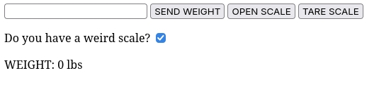

Program that weighs food for food drives. Uses webserial to connect to a USB scale.

Got to an okay MVP, the code that is there is pretty robust, other than the scale checkbox. Weird scale checkbox uses a slightly different interface over the serial port, as some scales that were used at the food drive were weird, hence the naming.

Things that need to be added:

- Auth
- Leaderboard
- Export
- Clear
- Roster option
- Set up on scout domain
- Tare scale (Function is made, but not sure how to have it stop the main reading function)
  - Now that I think about it, what if in the normal reading function we check if a switch has been flipped (flip via button) then if it is, tare scale, then go back to reading and flip the switch off again.

### Dev notes

- Make sure that the user has permissions for the serial port on Linux

### Installation

1. Clone repo
2. Install dependencies using `npm install`
3. Run dev server using `npm run dev`
